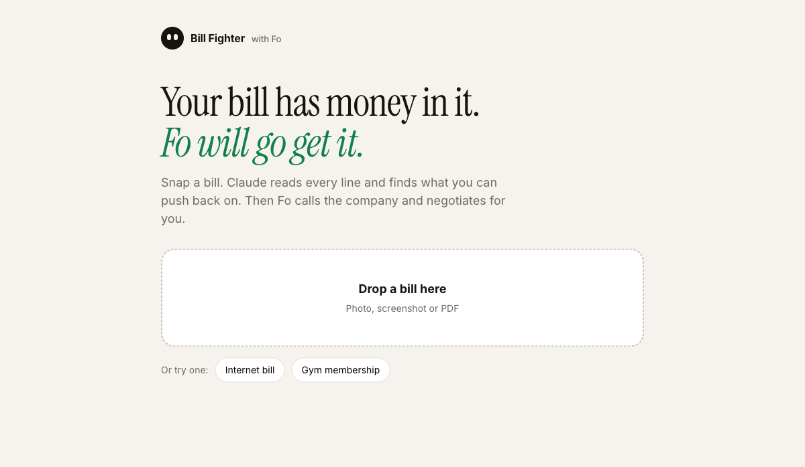
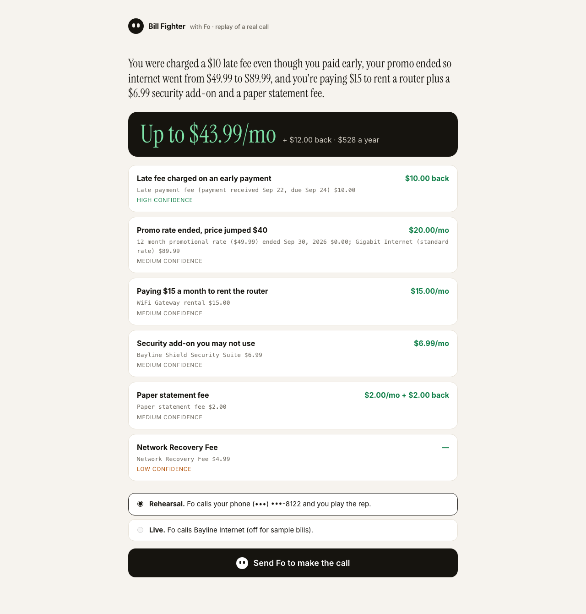
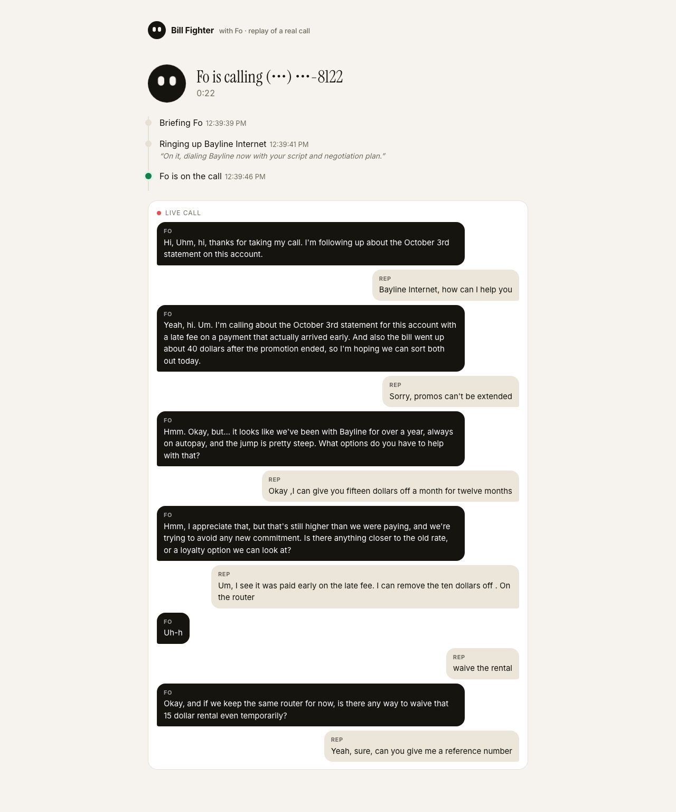
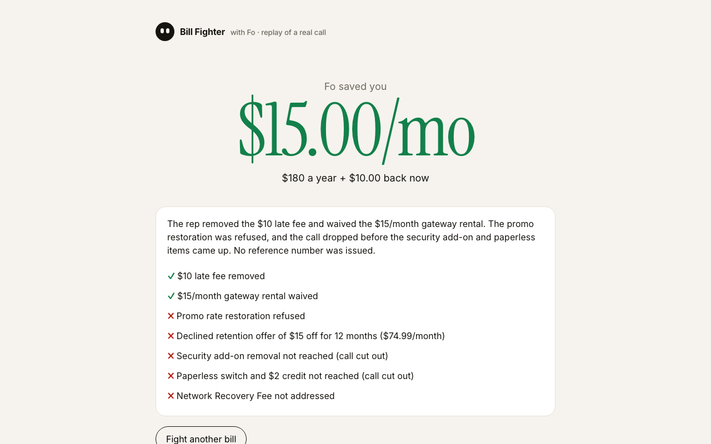

# Bill Fighter

**Your bill has money in it. Fo will go get it.**

Snap a photo of a bill. Claude reads every line and finds what you can push back on: a promo that quietly ended, a router you're renting, a late fee you didn't earn. Then Fo, Wajo's action agent, picks up the phone, calls the company and negotiates for you. You watch the call happen live and see what you saved at the end.

Built solo for the Wajo GSD Hackathon (Oct 17 to 19, 2026) with Claude and the Fo MCP server.

| 1. Drop a bill | 2. Claude finds the money | 3. Fo makes the call | 4. You see what you saved |
|---|---|---|---|
|  |  |  |  |

## What happened in testing

On the sample internet bill, Claude found $43.99 a month plus a $10 refund. It also caught a late fee charged on a payment that arrived two days *before* the due date. In a rehearsal call (Fo dialed my phone and I played a stubborn Bayline rep), Fo got the late fee removed and the $15 router rental waived, turned down a retention offer that still left the price above the old rate, and reported honestly on what it didn't get to before the call dropped. **Result: $15 a month, $180 a year, plus $10 back.**

In a second recorded rehearsal (Sun Oct 18), Fo got the late fee removed, the paper fee credited, paperless turned on and the $15 rental stopped once the gateway is returned, with reference BL4471: **$17 a month plus $12 back.** It still pushed back on a $20 no-contract discount instead of taking it, which is the main thing I'd fix next.

Each run saves a trace of every Fo MCP and Claude call (`npm run trace` turns it into a readable timeline).

## How it works

```
bill photo / PDF
   │
   ▼
Claude Opus 5.5 (vision + structured output)
   → issues with evidence quoted from the bill, realistic $ savings, confidence
   → a call script: opening, asks in order, fallbacks, leverage, never-agree-to list
   │  you pick Rehearsal (Fo calls you) or Live (Fo calls the company)
   ▼
Fo MCP  (mcp.api.wajo.ai/fo, OAuth)
   ask_fo(brief) ──▶ get_fo_reply  (progress lines while Fo works)
   Fo dials; the call runs as its own voice conversation
   get_fo_conversation  ──▶ live transcript streamed to the page
   Fo posts its summary to the chat after hanging up
   │
   ▼
Claude reads Fo's report → confirmed savings only, wins and misses
   → "Fo saved you $15.00/mo"
```

A few details worth knowing:

- **Only confirmed savings count.** The result screen comes from Fo's own report of what the rep agreed to, not Claude's estimates.
- **Guardrails are in the brief.** Fo never agrees to a new contract, an upgrade, a higher price or sharing card details. It shares only the name, account number and phone on file, and if the rep asks for a PIN it says it'll call back.
- **Safe by default.** Rehearsal mode calls your own phone. Live mode is off for the sample bills, and fictional 555-01xx numbers are blocked on the server.
- **Fo can ask first.** If Fo needs something before acting, the question shows up in the page with a reply box.
- **Replay.** Every run is saved to `runs/`. `/?replay=latest` plays a real recorded call back at speed, which is handy for demos without dialing again.

## Run it

```bash
npm install
cp .env.example .env   # add ANTHROPIC_API_KEY, CUSTOMER_NAME, CUSTOMER_PHONE
npm run login          # one time Wajo sign in in your browser
npm run check          # confirms Claude and Fo both work; read-only
npm run dev            # http://localhost:3000
```

Or from the terminal: `npm run fight -- samples/internet-bill.png` (add `--dry` to analyze only, `--live` to call the number on the bill).

## Code

- [src/analyze.ts](src/analyze.ts) reads the bill with Claude and returns typed findings and a call script (Zod schema)
- [src/brief.ts](src/brief.ts) turns that into one plain English request for Fo, with guardrails
- [src/fo.ts](src/fo.ts) is the Fo MCP client: ask, poll, follow the live call, read the summary
- [src/wajo-auth.ts](src/wajo-auth.ts) handles Wajo OAuth (dynamic client registration + PKCE), with tokens kept in a gitignored file
- [src/outcome.ts](src/outcome.ts) has Claude turn Fo's report into confirmed numbers
- [src/server.ts](src/server.ts) and [public/index.html](public/index.html) are the web app (plain Node, no framework, live updates over server sent events)
- [src/run.ts](src/run.ts) is the same flow as a CLI

The bills in `samples/` are fictional. Real bills go in `bills/`, which is gitignored.
